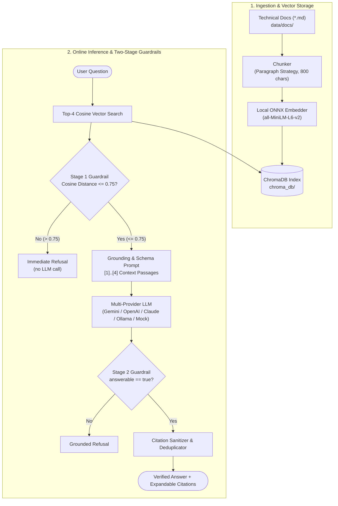

# Enterprise IT Support Assistant (RAG)

An enterprise-grade, retrieval-augmented generation (RAG) assistant that resolves technical IT queries grounded in verified documentation with interactive source citations. Engineered with a **two-stage refusal guardrail** that refuses instead of guessing when the knowledge base doesn't cover a question.

[](https://www.python.org/)
[](https://fastapi.tiangolo.com/)
[-orange.svg)](https://www.trychroma.com/)
[-61dafb.svg)](https://react.dev/)
[](https://github.com/Rohitgoud45/IT-Support-RAG/actions/workflows/test.yml)

**Live demo:** _link goes here once the Hugging Face Space is up_

Try an IT question ("VPN says error 809"), then something off-topic ("how do I bake cookies?") and see it refuse, along with which guardrail stopped it and why.

---

## Technical Documentation & Portfolios

* **[Architecture & Deep Design Specification](docs/ARCHITECTURE.md):** Complete component breakdown, sequence diagrams, latency budgets, and engineering trade-offs.
* **[Evaluation Benchmark & Quality Proof](docs/EVALUATION.md):** Formal metric definitions, 15-scenario golden dataset, ablation studies and how to reproduce them.
* **[AI Code Review & Verification Log](docs/AI_CODE_REVIEW.md):** Engineering audit log detailing critical fixes made to AI-generated code.

---

## Architecture Overview



### Core Technical Highlights
1. **Local Privacy-Preserving Vector Pipeline:** Vectors are generated locally via ChromaDB's embedded ONNX runtime (`all-MiniLM-L6-v2`). Internal enterprise IT documentation never leaves the host environment during ingestion or query vectorization.
2. **Two-Stage Refusal Guardrails:**
   - **Stage 1 (Embedding Distance Cutoff):** Queries with minimum cosine distance $> 0.75$ are refused immediately without invoking an LLM, so out-of-domain queries cost no LLM tokens.
   - **Stage 2 (Model Grounding & Schema Guardrail):** Enforces a strict JSON contract (`{"answerable": bool, "answer": str, "citations": list[int]}`). If context is missing required facts, the LLM refuses without guessing.
3. **Resilient Multi-Provider Adapter:** Supports Google Gemini, OpenAI, Anthropic, local self-hosted endpoints (Ollama / LM Studio / vLLM via `OPENAI_BASE_URL`), and a high-fidelity offline mock mode with automated exponential backoff.

---

## Working Demo

### Option 1: Single-Command Full-Stack Web App (Recommended)
FastAPI serves both the REST API and the pre-compiled React single-page application out of the box on port 8000:

```bash
# 1. Setup virtual environment & dependencies
python -m venv .venv && source .venv/bin/activate  # Windows: .venv\Scripts\activate
pip install -r requirements-dev.txt   # runtime deps + pytest
cp .env.example .env

# 2. Build index and launch unified application
python -m app.ingest
uvicorn app.main:app --host 0.0.0.0 --port 8000
```
Open **`http://localhost:8000`** in your browser.

*(Optional)* To develop frontend with hot module reloading:
```bash
cd frontend && npm install && npm run dev   # UI on :5173, proxies /api to :8000
```

### Option 2: Interactive Terminal Demo (`scripts/demo.py`)
Experience the two-stage guardrails, vector cosine distances, latency timings, and verified citations directly in your terminal without opening a browser:

```bash
python scripts/demo.py
```
* Includes pre-configured demonstration scenarios (VPN error 809, password policies, cookie recipe refusal, Linux dual-boot refusal) plus custom freeform query testing.

### Option 3: Docker Container
```bash
docker compose up --build      # http://localhost:8000
```

---

## Reproducible Automated Tests

Tests run offline against a mock LLM and build their own temporary index, so they pass on a fresh clone without touching `chroma_db/`. CI runs them on every push (first run downloads the local embedding model):

```bash
pytest
```

### Test Suite Structure
* **`tests/test_guardrails.py`:** Stage 1 distance cutoff boundaries ($D_{\text{cos}} \le 0.75$ vs. $> 0.75$), Stage 2 schema refusals, citation boundary sanitization, and duplicate citation deduplication.
* **`tests/test_api_endpoints.py`:** FastAPI `/api/health` and `/api/ask` contracts, Pydantic input length validation ($3 \le \text{chars} \le 500$), and upstream failure handling (502).
* **`tests/test_core.py`:** Paragraph vs. fixed chunking, overlap preservation, JSON code-fence parsing, multi-provider auto-detection, and local ChromaDB retrieval.

---

## Documented Evaluation Benchmark

The harness scores 25 questions (20 answerable, 5 unanswerable) across 12 knowledge-base docs in `eval/questions.jsonl` and writes `eval/results.json`. Numbers are not quoted here until a fresh run is committed.

### Run the Evaluation Harness
```bash
# Live evaluation with real LLM provider (resumable with checkpoints):
python -m eval.run_eval

# Deterministic offline evaluation (CI/CD smoke test):
python -m eval.run_eval --allow-mock
```
See **[docs/EVALUATION.md](docs/EVALUATION.md)** for metric definitions.

---

## Project Structure

```
it-support-rag/
├── app/
│   ├── config.py         # Central configuration, defaults, and threshold parameters
│   ├── chunking.py       # Paragraph & fixed chunking strategies
│   ├── store.py          # ChromaDB client & local ONNX embedding binding
│   ├── ingest.py         # Document ingestion & vector indexing pipeline
│   ├── retrieval.py      # Top-K vector search with cosine distance calculation
│   ├── llm.py            # Multi-provider adapter (Gemini, OpenAI, Claude, Ollama, Mock)
│   ├── generate.py       # Two-stage guardrails & citation attribution logic
│   ├── ratelimit.py      # Per-IP rate limit + daily LLM call budget for public demos
│   └── main.py           # FastAPI server & static SPA serving
├── data/docs/            # 12 Markdown IT help articles (VPN, MFA, email, Teams, security, ...)
├── docs/
│   ├── ARCHITECTURE.md   # Comprehensive system architecture & design specification
│   ├── EVALUATION.md     # Evaluation framework, benchmark results, & ablation studies
│   └── AI_CODE_REVIEW.md # Review checklist & verification log of AI pair programming
├── eval/
│   ├── questions.jsonl   # 25 golden evaluation scenarios (20 in-domain, 5 out-of-domain)
│   ├── results.json      # Written by run_eval.py; commit it after a real run
│   └── run_eval.py       # Resumable evaluation harness with LLM-as-a-judge
├── frontend/             # React + Vite single-page application with citation explorer
├── scripts/
│   └── demo.py           # Interactive colorized CLI demonstration tool
├── tests/
│   ├── conftest.py       # Pytest fixtures for deterministic offline test isolation
│   ├── test_core.py      # Core unit tests for chunking, parsing, retrieval, and API
│   ├── test_guardrails.py# Dedicated boundary tests for Stage 1 & Stage 2 guardrails
│   └── test_api_endpoints.py # Validation & API contract tests
├── .github/workflows/    # CI: pytest on every push; deploy to Hugging Face after tests pass
├── requirements.txt      # Pinned runtime dependencies
├── requirements-dev.txt  # + pytest
├── pytest.ini            # Pytest configuration with pythonpath discovery
└── Dockerfile            # Container definition for unified full-stack deployment
```

## Deployment (Hugging Face Spaces)

The repo runs as a Docker Space with no changes; the YAML block at the top of this README is the Space config.

1. Create a Space on huggingface.co with SDK **Docker** (blank template).
2. In the Space settings, add a secret `GEMINI_API_KEY` (a free key from Google AI Studio works). Without a key the app runs in offline mock mode.
3. In this GitHub repo, add secret `HF_TOKEN` (a Hugging Face write token) and variable `HF_SPACE` (e.g. `your-name/it-support-rag`).
4. Push to `main`. After tests pass, `.github/workflows/deploy-hf.yml` pushes the code to the Space and it rebuilds.

### Abuse limits

`/api/ask` has no login, and each question that passes the distance check is a paid LLM call, so the app limits itself:

| Setting | Default | What it does |
|---|---|---|
| `RATE_LIMIT_PER_MIN` | 8 | Questions per visitor IP per rolling minute (HTTP 429 after that) |
| `DAILY_LLM_CALLS` | 300 | Model calls per UTC day across all visitors (HTTP 503 after that). Distance refusals are free and don't count |

Both are in-memory, so they reset on restart and assume a single container. Set either to `0` to turn it off.
