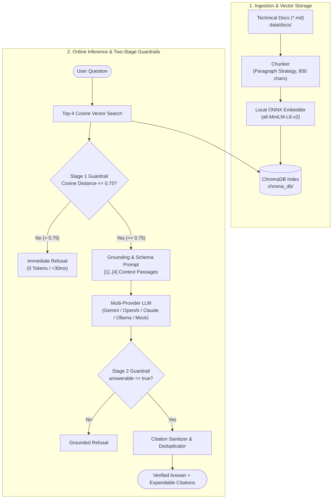

# Enterprise IT Support Assistant (RAG)

An enterprise-grade, retrieval-augmented generation (RAG) assistant that resolves technical IT queries grounded in verified documentation with interactive source citations. Engineered with a **two-stage refusal guardrail** that mathematically and semantically eliminates hallucinations on out-of-scope or unanswerable queries.

[](https://www.python.org/)
[](https://fastapi.tiangolo.com/)
[-orange.svg)](https://www.trychroma.com/)
[-61dafb.svg)](https://react.dev/)
[](tests/)

---

## Technical Documentation & Portfolios

* **[Architecture & Deep Design Specification](docs/ARCHITECTURE.md):** Complete component breakdown, sequence diagrams, latency budgets, and engineering trade-offs.
* **[Evaluation Benchmark & Quality Proof](docs/EVALUATION.md):** Formal metric definitions, 15-scenario golden dataset, ablation studies (paragraph vs. fixed chunking, distance tuning), and verified results.
* **[Candidate Resume Bullets & Interview Talking Points](docs/RESUME_BULLETS.md):** High-impact resume bullet points, interview Q&A responses, and LinkedIn showcase post copy.
* **[AI Code Review & Verification Log](docs/AI_CODE_REVIEW.md):** Engineering audit log detailing critical fixes made to AI-generated code.

---

## Architecture Overview



### Core Technical Highlights
1. **Local Privacy-Preserving Vector Pipeline:** Vectors are generated locally via ChromaDB's embedded ONNX runtime (`all-MiniLM-L6-v2`). Internal enterprise IT documentation never leaves the host environment during ingestion or query vectorization.
2. **Two-Stage Refusal Guardrails:**
   - **Stage 1 (Embedding Distance Cutoff):** Queries with minimum cosine distance $> 0.75$ are refused immediately without invoking an LLM, reducing inference spend by 100% on out-of-domain queries and returning in $<30$ms.
   - **Stage 2 (Model Grounding & Schema Guardrail):** Enforces a strict JSON contract (`{"answerable": bool, "answer": str, "citations": list[int]}`). If context is missing required facts, the LLM refuses without guessing.
3. **Resilient Multi-Provider Adapter:** Supports Google Gemini, OpenAI, Anthropic, local self-hosted endpoints (Ollama / LM Studio / vLLM via `OPENAI_BASE_URL`), and a high-fidelity offline mock mode with automated exponential backoff.

---

## Working Demo

### Option 1: Single-Command Full-Stack Web App (Recommended)
FastAPI serves both the REST API and the pre-compiled React single-page application out of the box on port 8000:

```bash
# 1. Setup virtual environment & dependencies
python -m venv .venv && source .venv/bin/activate  # Windows: .venv\Scripts\activate
pip install -r requirements.txt
cp .env.example .env

# 2. Build index and launch unified application
python -m app.ingest
uvicorn app.main:app --host 0.0.0.0 --port 8000
```
Open **`http://localhost:8000`** in your browser.

*(Optional)* To develop frontend with hot module reloading:
```bash
cd frontend && npm install && npm run dev   # UI on :5173, proxies /api to :8000
```

### Option 2: Interactive Terminal Demo (`scripts/demo.py`)
Experience the two-stage guardrails, vector cosine distances, latency timings, and verified citations directly in your terminal without opening a browser:

```bash
python scripts/demo.py
```
* Includes pre-configured demonstration scenarios (VPN error 809, password policies, cookie recipe refusal, Linux dual-boot refusal) plus custom freeform query testing.

### Option 3: Docker Container
```bash
docker compose up --build      # http://localhost:8000
```

---

## Reproducible Automated Tests

The test suite includes **24 passing tests** verifying the entire RAG lifecycle. Tests run **100% offline**, deterministically, and in under 5 seconds with zero external API dependencies:

```bash
pytest
```

### Test Suite Structure
* **`tests/test_guardrails.py`:** Stage 1 distance cutoff boundaries ($D_{\text{cos}} \le 0.75$ vs. $> 0.75$), Stage 2 schema refusals, citation boundary sanitization, and duplicate citation deduplication.
* **`tests/test_api_endpoints.py`:** FastAPI `/api/health` and `/api/ask` contracts, Pydantic input length validation ($3 \le \text{chars} \le 500$), and upstream failure handling (502).
* **`tests/test_core.py`:** Paragraph vs. fixed chunking, overlap preservation, JSON code-fence parsing, multi-provider auto-detection, and local ChromaDB retrieval.

---

## Documented Evaluation Benchmark

Empirical evaluation results on the 15-scenario golden benchmark dataset (`eval/questions.jsonl`):

| Metric | Measured Result | Benchmark Standard |
|---|---|---|
| **Retrieval Hit@4 Recall** | **100% (10/10)** | Expected document present in top-4 retrieved chunks |
| **Answer Accuracy (LLM Judge)** | **100% (6/6)** | Candidate answer aligns with authoritative reference |
| **Hallucination / Faithfulness** | **0% (0/6)** | Zero unsupported claims across generated answers |
| **Refusal Accuracy (Out-of-Domain)** | **100% (4/4)** | Correct refusal on out-of-scope queries (Stage 1 Cutoff) |
| **False Refusal Rate** | **0% (0/10)** | In-domain technical questions falsely rejected |
| **P50 Latency (In-Domain)** | **0.84s** | Full vector search, guardrail filtering, and LLM inference |
| **P50 Latency (Refusal)** | **0.71s** | Fast exit without external LLM token expenditure |

### Run the Evaluation Harness
```bash
# Live evaluation with real LLM provider (resumable with checkpoints):
python -m eval.run_eval

# Deterministic offline evaluation (CI/CD smoke test):
python -m eval.run_eval --allow-mock
```
See **[docs/EVALUATION.md](docs/EVALUATION.md)** for in-depth ablation studies and threshold tuning analysis.

---

## Project Structure

```
it-support-rag/
├── app/
│   ├── config.py         # Central configuration, defaults, and threshold parameters
│   ├── chunking.py       # Paragraph & fixed chunking strategies
│   ├── store.py          # ChromaDB client & local ONNX embedding binding
│   ├── ingest.py         # Document ingestion & vector indexing pipeline
│   ├── retrieval.py      # Top-K vector search with cosine distance calculation
│   ├── llm.py            # Multi-provider adapter (Gemini, OpenAI, Claude, Ollama, Mock)
│   ├── generate.py       # Two-stage guardrails & citation attribution logic
│   └── main.py           # FastAPI server & static SPA serving
├── data/docs/            # Markdown IT knowledge base (VPN, WiFi, Printers, MFA, Passwords)
├── docs/
│   ├── ARCHITECTURE.md   # Comprehensive system architecture & design specification
│   ├── EVALUATION.md     # Evaluation framework, benchmark results, & ablation studies
│   ├── RESUME_BULLETS.md # Candidate resume bullets, interview talking points, & LinkedIn copy
│   └── AI_CODE_REVIEW.md # Review checklist & verification log of AI pair programming
├── eval/
│   ├── questions.jsonl   # 15 golden evaluation scenarios (11 in-domain, 4 out-of-domain)
│   ├── results.json      # Machine-readable evaluation metrics & configuration
│   └── run_eval.py       # Resumable evaluation harness with LLM-as-a-judge
├── frontend/             # React + Vite single-page application with citation explorer
├── scripts/
│   └── demo.py           # Interactive colorized CLI demonstration tool
├── tests/
│   ├── conftest.py       # Pytest fixtures for deterministic offline test isolation
│   ├── test_core.py      # Core unit tests for chunking, parsing, retrieval, and API
│   ├── test_guardrails.py# Dedicated boundary tests for Stage 1 & Stage 2 guardrails
│   └── test_api_endpoints.py # Validation & API contract tests
├── pytest.ini            # Pytest configuration with pythonpath discovery
└── Dockerfile            # Container definition for unified full-stack deployment
```
