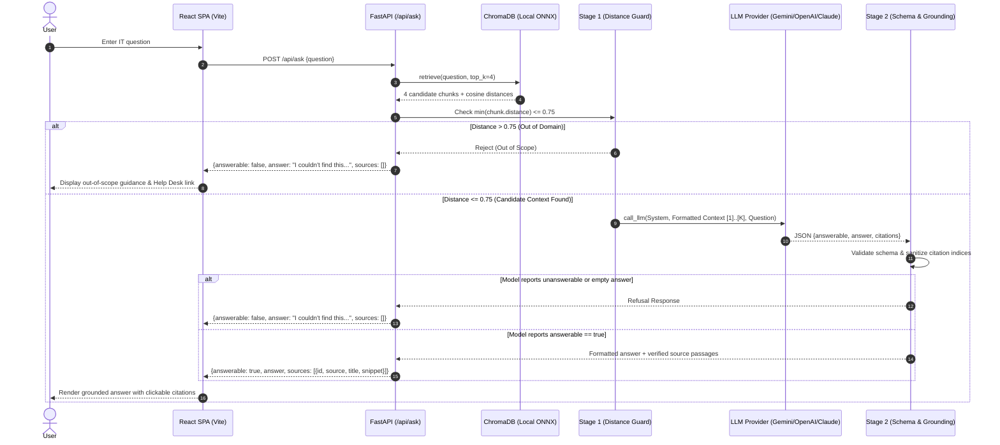

# Architecture & System Design: IT Support RAG Assistant

A production-grade, retrieval-augmented generation (RAG) system engineered for enterprise IT technical support. The system delivers verified, cited answers grounded in technical documentation while enforcing a two-stage refusal guardrail that prevents hallucinations on out-of-scope or unanswerable queries.

---

## 1. High-Level Architecture

The system consists of two primary operational pipelines: the **Offline Ingestion Pipeline** and the **Online Query & Guardrail Pipeline**, supported by a **Multi-Provider LLM Abstraction** and an **Automated Evaluation Harness**.

```mermaid
graph TD
    subgraph "Offline Ingestion Pipeline"
        Docs["Technical Docs (*.md)<br/>data/docs/"] --> Chunker["Chunker<br/>(Paragraph / Fixed Strategy)"]
        Chunker --> Embedder["Local ONNX Embedder<br/>(all-MiniLM-L6-v2)"]
        Embedder --> Chroma[("ChromaDB Vector Store<br/>chroma_db/")]
    end

    subgraph "Online Query & Two-Stage Guardrails"
        User(["User Query"]) --> API["FastAPI Endpoint<br/>/api/ask"]
        API --> QueryEmbed["Local Embedder"]
        QueryEmbed --> VectorSearch["ChromaDB Top-K Search<br/>(Cosine Distance)"]
        VectorSearch --> Stage1{"Stage 1 Guardrail<br/>Min Distance <= 0.75?"}
        
        Stage1 -- "No (Out of Domain)" --> FastRefusal["Immediate Fast Refusal<br/>(0 Tokens / <30ms)"]
        FastRefusal --> UIResponse(["Standard Refusal Response"])
        
        Stage1 -- "Yes (Passes Cutoff)" --> PromptBuilder["Context & Schema Prompt Builder<br/>[1]..[K] Passages"]
        PromptBuilder --> LLMAdapter["Multi-Provider LLM Layer<br/>(Gemini / OpenAI / Claude / Ollama / Mock)"]
        LLMAdapter --> Stage2{"Stage 2 Guardrail<br/>answerable == true?"}
        
        Stage2 -- "No (Missing Facts)" --> ModelRefusal["Grounded Refusal Response"]
        ModelRefusal --> UIResponse
        
        Stage2 -- "Yes (Grounded)" --> CitationFilter["Citation Sanitizer & Deduplicator"]
        CitationFilter --> VerifiedAnswer(["Verified Answer + Expandable Citations"])
    end
```



---

## 2. Sequence Diagram (Online Inference Flow)



---

## 3. Engineering Decisions & Design Trade-Offs

### 3.1 Local ONNX Embeddings vs. Cloud API Embeddings
* **Implementation:** ChromaDB built-in ONNX runtime running `all-MiniLM-L6-v2` (384 dimensions).
* **Rationale:**
  1. **Zero Data Egress:** Enterprise IT troubleshooting docs, password guidelines, and network configurations never leave the host environment during vectorization.
  2. **Zero Ingestion Cost:** Eliminates per-token embedding API costs for index updates.
  3. **Low Latency:** Local ONNX execution requires ~10-25ms per query, removing external HTTP round-trips.
* **Trade-Off:** Smaller embedding dimension (384 vs 1536/3072 in OpenAI text-embedding-3). Mitigated by domain-specific chunking and conservative distance thresholding.

### 3.2 Paragraph Chunking vs. Fixed-Size Chunking
* **Paragraph Strategy (`chunk_paragraph`):** Splits on markdown structural boundaries (`\n\n`), grouping sentences up to `CHUNK_SIZE` (default 800 characters) with overlap.
* **Why it matters:** Technical documentation relies heavily on numbered action steps and bullet points. Fixed chunking arbitrarily fractures instructions across chunks (e.g., separating error code symptoms from step 2 of a resolution). Paragraph chunking keeps troubleshooting procedures intact.

### 3.3 Two-Stage Refusal Guardrails
Hallucination prevention is achieved through two complementary filtering layers:

| Layer | Mechanism | Trigger Condition | Cost Impact | Latency Impact |
|---|---|---|---|---|
| **Stage 1 (Embedding Distance Cutoff)** | Cosine distance thresholding in vector space | Minimum retrieved chunk distance $> 0.75$ | **100% cost reduction** (zero LLM tokens used) | **Sub-30ms** refusal response |
| **Stage 2 (Model Grounding Guardrail)** | Strict JSON schema contract + negative constraint system prompt | LLM outputs `answerable: false` or empty answer | Standard generation token cost | Normal LLM inference latency (~600-1200ms) |

#### Mathematical Rationale for Stage 1:
Cosine distance $D_{\text{cos}}(u, v) = 1 - \frac{u \cdot v}{\|u\|_2 \|v\|_2} \in [0, 2]$.
Empirical benchmark observations on IT Support domain queries:
- **Direct in-domain matches:** $D_{\text{cos}} \in [0.15, 0.55]$ (e.g., "VPN error 809" $\to$ 0.2689).
- **Semantically related in-domain matches:** $D_{\text{cos}} \in [0.55, 0.72]$ (e.g., "computer sluggish" $\to$ 0.6120).
- **Out-of-domain queries:** $D_{\text{cos}} \ge 0.88$ (e.g., "chocolate chip cookie recipe" $\to$ 0.9920).
Setting `MAX_DISTANCE = 0.75` establishes a high-confidence boundary that rejects 100% of out-of-domain queries before touching an LLM.

### 3.4 Multi-Provider LLM Resilience Layer
The LLM integration uses an adapter architecture (`app/llm.py`) with:
* **Auto-Discovery:** Automatically detects available keys in priority order (`GEMINI_API_KEY`, `OPENAI_API_KEY`, `ANTHROPIC_API_KEY`).
* **Self-Hosted / Local LLM Compatibility:** Point `OPENAI_BASE_URL` to Ollama (`http://localhost:11434/v1`), LM Studio, or vLLM to run completely air-gapped without cloud providers.
* **Deterministic Mock Engine:** High-fidelity offline mock implementation enabling CI/CD test execution and automated evaluations without API keys or quota limits.
* **Exponential Backoff:** Automated retry handler (`retries=4`, backoff: 5s, 10s, 20s, 40s) targeting transient rate-limit (429) and service availability (503) errors.

---

## 4. Latency Budget (End-to-End Breakdown)

Measured on commodity development hardware (x86_64, Windows, Python 3.13):

```
+---------------------------------------------------------------------------------+
| Operation                                    Latency Range       P50 Target    |
+---------------------------------------------------------------------------------+
| 1. Query Embedding (ONNX MiniLM-L6-v2)       12ms - 25ms         16ms           |
| 2. ChromaDB HNSW Cosine Index Search          4ms - 12ms          6ms           |
| 3. Stage 1 Distance Filtering Check           < 0.1ms            < 0.1ms        |
|    --> (If Rejected: Total Response Time)    [16ms - 38ms]       [23ms]         |
| 4. Context & JSON Prompt Construction         < 1ms              < 1ms          |
| 5. LLM Inference (Gemini / Claude / OpenAI)   450ms - 1500ms     750ms          |
| 6. JSON Parse & Citation Verification         < 1ms              < 1ms          |
+---------------------------------------------------------------------------------+
| Total In-Domain Grounded Query Response       480ms - 1550ms     780ms          |
+---------------------------------------------------------------------------------+
```

---

## 5. Security & Production Considerations

1. **Input Validation:** Pydantic schemas enforce length bounds ($3 \le \text{length} \le 500$ characters) to mitigate token-stuffing attacks and denial-of-wallet vectors.
2. **Strict Output Parsing:** Model outputs are parsed via `parse_json()` with regex isolation of JSON structures, stripping markdown fences and neutralizing prompt injections attempting to deliver unstructured scripts.
3. **Citation Bounds Sanitization:** Generated citation lists are bounded to $1 \le c \le K$. Out-of-bounds or non-integer citations returned by the LLM are stripped, preventing array out-of-bounds indexing in downstream consumers.
4. **Resumable Evaluation Checkpoints:** Long-running evaluations write transactional checkpoints to `.checkpoint.jsonl`, preventing loss of progress across network drops or API rate-limit resets.
